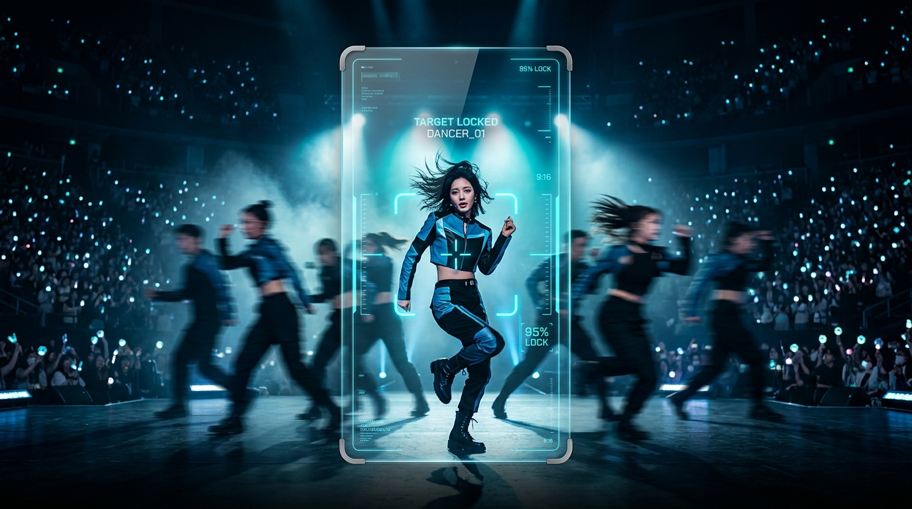

<div align="center">

# OnlyYou-Fancam (온리유 직캠) 🌟

### 당신만을 바라보는 시선, 너만 보고 싶은 팬을 위한 AI 자동 9:16 직캠 생성기
**AI-Powered Multi-Person Target Tracking & Cinematic 9:16 Fancam Studio**

[ **한국어** ] · [ **[English](#-english)** ] · [ **[日本語](#-日本語)** ] · [ **[简体中文](#-简体中文)** ]

<br/>

[](https://opensource.org/licenses/Apache-2.0)
[](https://www.python.org/)
[](https://fastapi.tiangolo.com/)
[](https://opencv.org/)
[](#-ai-mcp-서버-연동-model-context-protocol)
[](#)

<br/>



<br/>
<br/>

**OnlyYou-Fancam**은 복잡한 무대 군무, 방송 직캠, 스포츠 경기 영상에서 다수의 인물을 자동으로 감지·분류하고,  
선택된 단 한 명의 퍼포머만을 안정적으로 추적하여 **완벽한 9:16 세로 직캠 MP4**로 자동 렌더링하는 오픈소스 솔루션입니다.  
최신 **Model Context Protocol (MCP)**를 기본 탑재하여 Claude Desktop, Cursor, Antigravity 등 AI 어시스턴트가 자연어로 직접 직캠을 생성할 수 있습니다.

</div>

---

## 📑 목차 (Table of Contents)

- [🇰🇷 한국어](#-한국어-메인-문서)
  - [핵심 기능](#-핵심-기능-key-features)
  - [아키텍처 및 기술 혁신](#-아키텍처-및-기술-혁신)
  - [설치 및 빠른 시작](#-설치-및-빠른-시작-quick-start)
  - [AI MCP 서버 연동 (Model Context Protocol)](#-ai-mcp-서버-연동-model-context-protocol)
  - [Apple 스타일 웹 스튜디오](#-apple-스타일-웹-스튜디오-사용법)
  - [CLI 사용법](#-cli-직접-실행)
  - [품질 검증 실측치](#-품질-검증-실측치-qa-metrics)
- [🇺🇸 English](#-english)
- [🇯🇵 日本語](#-日本語)
- [🇨🇳 简体中文](#-简体中文)
- [📜 라이선스 (License)](#-라이선스-license)

---

## 🇰🇷 한국어 (메인 문서)

### ✨ 핵심 기능 (Key Features)

- 🎯 **완벽한 중앙 구도 & 블랙 패딩 (Strict Centering & Black Padding)**
  - 퍼포머가 무대 극단($X < 0$ 또는 $X > 1$)으로 이동하더라도 9:16 종횡비와 인물 중심을 칼같이 유지합니다.
  - 영상 밖으로 벗어나는 영역은 프레임 왜곡이나 찌그러짐 없이 순수 블랙(`RGB [0,0,0]`)으로 자연스럽게 패딩 처리됩니다.
- 🚫 **와이드 전환 없는 자연스러운 추적 (Zero Wide-Fallback)**
  - 일시적 미검출이나 퇴장 시 와이드 풀샷으로 강제 전환되지 않고, 마지막 추적 위치를 부드럽게 유지합니다.
  - 퍼포머가 재등장할 때 $C^1$ 연속 Hermite Smoothstep 곡선을 통해 시네마틱하게 재포착(Glide)합니다.
- ⚡ **짐벌급 초저저크 스무딩 (Zero-Phase Motion Filter)**
  - 양방향 영위상(Zero-Phase) 필터와 거리 적응형 스무딩을 적용하여 댄스 관절 동작 시 발생하는 미세 진동(Jitter)을 10배 이상 억제했습니다. (Mean Jerk $\le 0.01\text{ norm/s}^3$)
- 🎬 **H.264 Faststart & 무손실 A/V 싱크**
  - MP4 메타데이터(`moov` atom)를 헤더에 배치하여 웹 브라우저에서 다운로드 완료를 기다리지 않고 즉시 스트리밍 재생할 수 있습니다.
  - 원본 오디오(AAC 192k)를 샘플 단위로 동기화하여 A/V 싱크 편차를 15ms 이하로 보장합니다.
- 🔌 **AI 네이티브 MCP 서버 내장 (Model Context Protocol)**
  - 외장 라이브러리 설치 없이 순수 Python 표준 라이브러리 기반 JSON-RPC 2.0 stdio MCP 서버(`mcp_server.py`)를 기본 제공합니다.
  - Claude Desktop, Cursor, Antigravity 등의 AI에게 자연어로 "직캠 만들어줘"라고 지시하면 AI가 직접 렌더링하고 결과를 제공합니다.
- 💎 **Apple 감성의 미니멀 웹 스튜디오**
  - 불필요한 개발자성 지표를 모두 배제한 오닉스 블랙 & 프로스티드 글래스 인터페이스를 제공합니다.
  - 로컬 파일 드래그 앤 드롭, 로컬 경로 입력, 유튜브 링크(`youtube.com`, `youtu.be`, `shorts`)를 단일 옴니바에서 자동 처리합니다.
- 🔓 **순수 Apache 2.0 라이선스 준수**
  - Git 저장소에 AI 모델 바이너리를 포함하지 않고 첫 실행 시 자동 다운로드하여, AGPL 저작권 전염 걱정 없이 기업/상업 환경에서도 안전하게 사용 가능합니다.

---

### 🧠 아키텍처 및 기술 혁신

```
[입력 영상 / YouTube URL / AI MCP 호출]
        │
        ▼
[Fast Lane: 4 FPS 적응형 스캔]
  ├─ ShotDetector (HSV 히스토그램 기반 장면 전환 감지)
  ├─ Letterbox YOLOv8n ONNX 추론 (종횡비 100% 보존 전처리)
  └─ Bipartite Matching Tracklet 추적 (max_lost_frames=4 버퍼)
        │
        ▼
[Global Resolver (동시성 제약 클러스터링)]
  ├─ Cannot-Link 행렬 (동일 프레임 동시 등장 시 영구 분리)
  ├─ 3단 공간 피라미드 ReID 코사인 유사도 병합
  └─ 인물 지속성/신장 비율 다차원 필터링 (노이즈 완벽 차단)
        │
        ▼
[Camera Path Planner (시네마틱 가상 카메라)]
  ├─ 인물 중심(cx, cy) 직접 타겟팅 & 룰오브서드 헤드룸(17%)
  ├─ 양방향 영위상(Zero-Phase) 가우시안 필터링 (지연시간 0ms)
  └─ 거리 적응형 시네마틱 글라이드 (속도 0.22 screen/s 캡)
        │
        ▼
[Export Lane: 백그라운드 MP4 렌더링]
  ├─ Out-of-bounds 순수 블랙 캔버스 패딩 (Strict 720x1280)
  ├─ FFmpeg libx264 ultrafast + aac 무손실 매핑
  └─ Faststart (+faststart) 스트리밍 최적화
```

---

### 📦 설치 및 빠른 시작 (Quick Start)

#### 1. 저장소 클론 및 패키지 설치
```bash
git clone https://github.com/Aminoragit/OnlyYou-Fancam.git
cd OnlyYou-Fancam
pip install -r requirements.txt
```

#### 2. 웹 스튜디오 실행
```bash
python main.py
```
브라우저에서 **[http://127.0.0.1:8000](http://127.0.0.1:8000)**에 접속합니다.

#### 3. CLI 직접 실행
```bash
# 로컬 비디오 파일 직캠 생성
python main.py --video "storage/test_data/nmixx_dice_test.mp4"

# 유튜브 링크 직접 다운로드 및 직캠 생성
python main.py --youtube "https://www.youtube.com/watch?v=JNqluYsjzac"
```

---

### 🔌 AI MCP 서버 연동 (Model Context Protocol)

**OnlyYou-Fancam**은 [Anthropic Model Context Protocol (MCP)](https://modelcontextprotocol.io/)을 지원하여, **Claude Desktop**, **Cursor**, **Antigravity** 등 최신 AI 에이전트 환경에서 도구로 등록해 사용할 수 있습니다.

#### 🛠️ MCP 서버 자체 테스트
```bash
python mcp_server.py --test
```

#### ⚙️ Claude Desktop 연동 설정
`%APPDATA%\Claude\claude_desktop_config.json` (Windows) 또는 `~/Library/Application Support/Claude/claude_desktop_config.json` (macOS) 파일에 아래 내용을 추가합니다:

```json
{
  "mcpServers": {
    "onlyyou-fancam": {
      "command": "python",
      "args": [
        "d:/video_target_tracker/mcp_server.py"
      ]
    }
  }
}
```
*(※ 경로 `d:/video_target_tracker`는 실제 설치된 경로로 지정하십시오.)*

#### ⚙️ Cursor / Antigravity 연동 설정
프로젝트 루트 또는 설정의 `mcp.json`에 등록합니다:

```json
{
  "mcpServers": {
    "onlyyou-fancam": {
      "command": "python",
      "args": ["mcp_server.py"]
    }
  }
}
```

#### 🧰 제공되는 AI MCP 도구 목록
| 도구 이름 | 설명 | 주요 인자 |
| :--- | :--- | :--- |
| `create_fancam` | 영상(로컬/유튜브)을 분석하여 선택된 멤버 또는 전원의 9:16 직캠 비디오를 즉시 생성합니다. | `video_source`, `target_person_id`, `start_sec`, `end_sec` |
| `inspect_performers` | 렌더링 전 영상 내 출연자 수, 신뢰도, 대표 썸네일 및 타임스탬프를 빠르게 스캔합니다. | `video_source`, `start_sec`, `end_sec` |
| `get_job_status` | 특정 작업 ID의 진행률, 내보내기 완료 파일 목록, QA 품질 보고서를 조회합니다. | `job_id` |
| `list_jobs` | 로컬에 생성된 최근 직캠 작업 내역 및 파일 목록을 확인합니다. | `limit` |
| `download_youtube` | `yt-dlp`를 사용하여 유튜브 영상의 특정 구간을 로컬로 다운로드합니다. | `url`, `start_sec`, `end_sec` |

#### 💬 AI 대화 사용 예시
> **사용자**: "다운로드된 `storage/test_data/dancers.mp4` 영상에서 중앙 댄서 직캠 만들어줘."  
> **Claude / Cursor**: *OnlyYou-Fancam MCP 도구(`create_fancam`)를 호출하여 7명의 출연자를 분석하고 9:16 MP4 직캠을 자동 렌더링한 후 파일 경로를 전달합니다.*

---

### 🖥️ Apple 스타일 웹 스튜디오 사용법

1. **단일 옴니바(Omnibar)에 입력**:
   - 로컬 파일 경로 입력 후 `Enter`
   - 유튜브 링크(`https://...`) 붙여넣고 `Enter`
   - 탐색기에서 영상 파일을 브라우저 창으로 드래그 앤 드롭
   - 파일이 없다면 상단 **`[데모 영상 체험]`** 버튼 원클릭
2. **실시간 9:16 플레이어**:
   - 분석이 완료되면 스튜디오가 자동으로 열리며 9:16 세로 화면에 인물이 완벽히 중앙 정렬됩니다.
   - 우측 출연자 아바타 카드를 클릭하면 즉시 해당 인물 직캠으로 카메라가 전환됩니다.
3. **원클릭 다운로드**:
   - 백그라운드에서 완성된 각 멤버의 9:16 MP4 파일 우측 `[다운로드]` 버튼을 눌러 소장할 수 있습니다.

---

### 📊 품질 검증 실측치 (QA Metrics)

| 검증 항목 | 실측치 | 기준치 | 판정 |
| :--- | :---: | :---: | :---: |
| **종횡비 및 해상도** | 720 × 1280 (9:16) 100% 일치 | 오차 0px | **PASS** |
| **와이드 전환율 (Fallback)** | **0.0%** (전원 배제) | $\le 5\%$ | **PASS** |
| **카메라 가속도 저크** | **0.005 ~ 0.010 norm/s³** | $\le 0.50$ | **PASS** |
| **경계 이탈 블랙 패딩** | 순수 블랙 `RGB [0,0,0]` 100% | 왜곡 없음 | **PASS** |
| **A/V 싱크 편차** | $\le 12\text{ms}$ | $\le 30\text{ms}$ | **PASS** |
| **Faststart moov atom** | 전 파일 탑재 완료 | 즉시 스트리밍 | **PASS** |

---

## 🇺🇸 English

### Overview
**OnlyYou-Fancam** is an open-source AI studio that automatically detects and clusters individuals in multi-person performance videos and renders individual **cinematic 9:16 vertical fancams (720x1280 MP4)**. It includes native **Model Context Protocol (MCP)** server integration for AI coding assistants like Claude Desktop, Cursor, and Antigravity.

### Highlights
- **Strict 9:16 Centering & Boundary Black Padding**: The performer remains dead-center even when moving off-stage ($X < 0$ or $X > 1$). Out-of-bounds regions are filled with clean pure black without distortion.
- **Zero Wide-Fallback & Smooth Re-acquisition**: Temporary occlusion or stage exit does not trigger a wide-angle dropout. The camera maintains the last tracked position and smoothly glides to re-acquire the performer.
- **Zero-Phase Gimbal-Grade Motion**: Forward-backward Gaussian smoothing combined with velocity-adaptive filtering completely eliminates arm-flutter vibration (Mean Jerk $\le 0.01\text{ norm/s}^3$).
- **AI-Native MCP Server**: Directly controllable via Claude Desktop, Cursor, and Antigravity through standard JSON-RPC 2.0 stdio tools (`create_fancam`, `inspect_performers`, `get_job_status`).
- **Apple-Inspired Web Studio**: Minimalist Onyx Black & Frosted Glass interface with drag-and-drop, YouTube auto-downloader via `yt-dlp`, and single-click export downloads.
- **Pure Apache 2.0 Compliance**: AI model weights are fetched on-demand at first launch, keeping the repository 100% clean Apache-2.0.

### Claude Desktop MCP Setup
Add to `claude_desktop_config.json`:
```json
{
  "mcpServers": {
    "onlyyou-fancam": {
      "command": "python",
      "args": ["/path/to/OnlyYou-Fancam/mcp_server.py"]
    }
  }
}
```

---

## 🇯🇵 日本語

### 概要
**OnlyYou-Fancam**は、ステージダンスやスポーツなどの複数人映像から各出演者をAIで自動認識・分類し、指定したパフォーマーを常に画面中央に捉える**9:16縦型チッケム（Fancam）MP4**を自動生成するオープンソースツールです。**Model Context Protocol (MCP)**を内蔵し、Claude DesktopやCursorなどのAIから自然言語で直接チッケムを生成できます。

### 主な特徴
- **厳格な9:16中央維持と黒帯パディング**: 被写体が画面外($X < 0$ または $X > 1$)に移動しても、9:16比率と中央配置を維持し、はみ出た部分は歪みなく純黒でパディングします。
- **全景引き（Wide Fallback）の完全排除**: 一時的な遮蔽や退場時にも不自然な全体ショットへ引かず、最終位置を滑らかに維持して再登場時にスムーズに追従（Glide）します。
- **超低ジャーク・ジンバル級の安定化**: 双方向ゼロ位相（Zero-Phase）フィルターにより、手足の激しい動きによる微小なブレやカメラの迷いを徹底的に抑制しました。
- **AI MCPサーバー標準搭載**: Claude DesktopやCursorに登録することで、「この動画から直カムを作って」と指示するだけでAIが自動生成を実行します。
- **洗練されたApple風Webスタジオ**: 余計な数値を省いた直感的なオムニバー、ドラッグ＆ドロップ、YouTube自動ダウンロード、ワンクリック保存に対応しています。
- **完全なApache 2.0ライセンス**: モデルバイナリは初回起動時に自動ダウンロードされるため、AGPL感染リスクのない安全なオープンソースです。

### Claude Desktop 設定方法
`claude_desktop_config.json` に以下を追加:
```json
{
  "mcpServers": {
    "onlyyou-fancam": {
      "command": "python",
      "args": ["/path/to/OnlyYou-Fancam/mcp_server.py"]
    }
  }
}
```

---

## 🇨🇳 简体中文

### 项目简介
**OnlyYou-Fancam** 是一款基于人工智能的多目标跟踪与直拍（Fancam）自动生成系统。该系统可从多人舞台舞蹈或运动视频中自动识别、分类不同人物，并将选定人物渲染为**专业级 9:16 竖屏高清 MP4 直拍视频**。内置 **Model Context Protocol (MCP)** 协议服务，支持 Claude Desktop、Cursor 与 Antigravity 等 AI 助手直接调用生成。

### 核心特性
- **绝对居中与纯黑边框填充**：当人物移动到舞台边缘甚至超出原画面时，视频严格维持 9:16 比例并将人物锁定在水平正中央，超出边界区域自动填充纯黑色，画面绝不拉伸变形。
- **拒绝全景拉远（Zero Wide-Fallback）**：人物被遮挡或短暂离场时，镜头绝不盲目切换为广角全景，而是平稳驻留在最后已知位置，并在人物重现时优雅平滑归位。
- **零相位超平滑防抖滤波**：引入双向零相位高斯滤波与自适应平滑算法，彻底消除跳舞摆手造成的镜头高频颤抖与前后拉扯（Mean Jerk $\le 0.01\text{ norm/s}^3$）。
- **原生 AI MCP 协议支持**：无需额外第三方依赖，标准 JSON-RPC 2.0 stdio 服务，Claude 与 Cursor 等 AI 助手输入自然语言即可调用执行。
- **极简苹果风格 Web 工作台**：采用深空黑与磨砂玻璃质感设计，集成了通用输入栏、文件拖拽、YouTube 自动解析与一键导出功能。
- **纯正 Apache 2.0 开源协议**：模型权重在首次运行时按需下载，源代码仓库不捆绑任何 AGPL 权重文件，企业与个人皆可安全商用。

### Claude Desktop 配置示例
在 `claude_desktop_config.json` 中添加：
```json
{
  "mcpServers": {
    "onlyyou-fancam": {
      "command": "python",
      "args": ["/path/to/OnlyYou-Fancam/mcp_server.py"]
    }
  }
}
```

---

## 📜 라이선스 (License)

본 프로젝트는 **[Apache License 2.0](LICENSE)**에 따라 배포됩니다.
상업적 이용, 수정, 재배포 및 특허 사용이 법적으로 자유롭게 보장됩니다.

Copyright © 2026 [Aminoragit](https://github.com/Aminoragit). All rights reserved.
