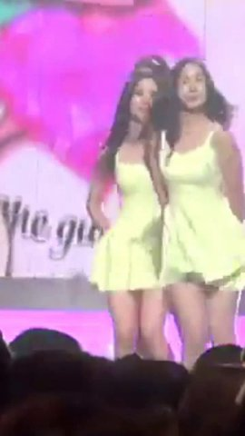
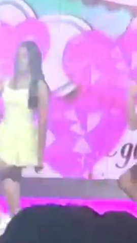
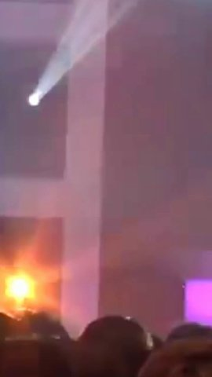
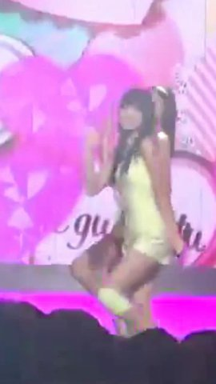

<div align="center">

# OnlyYou-Fancam 🌟

### AIを活用したマルチパーソントラッキング＆シネマティック9:16縦型チッケム（Fancam）スタジオ

[ **[English](README.md)** ] · [ **[한국어](README_kr.md)** ] · [ **日本語** ] · [ **[简体中文](README_zh.md)** ]

<br/>

[](https://opensource.org/licenses/Apache-2.0)
[](https://www.python.org/)
[](https://fastapi.tiangolo.com/)
[](https://opencv.org/)
[](#-ai-mcpサーバー連携-model-context-protocol)
[](#)

<br/>


<br/>
<br/>

**OnlyYou-Fancam**は、ステージダンスやスポーツなどの複数人映像から各出演者をAIで自動認識・分類し、  
指定したパフォーマーを常に画面中央に捉える**9:16縦型チッケム（720x1280 MP4）**を自動生成するオープンソースツールです。  
最新の**Model Context Protocol (MCP)**を内蔵し、Claude DesktopやCursorなどのAIから自然言語で直接チッケムを生成できます。

</div>

---

## 📑 目次

- [主な特徴](#-主な特徴)
- [システムアーキテクチャ](#-システムアーキテクチャ)
- [GFRIENDコンサート舞台テスト結果（5段階抽出テーブル）](#-gfriendコンサート舞台テスト結果)
- [品質検証ベンチマーク（QA Metrics）](#-品質検証ベンチマーク)
- [クイックスタート＆インストール](#-クイックスタート＆インストール)
- [AI MCPサーバー連携（Model Context Protocol）](#-ai-mcpサーバー連携-model-context-protocol)
- [Apple風Webスタジオの使い方](#-apple風webスタジオの使い方)
- [CLIの使い方](#-cliの使い方)
- [ライセンス](#-ライセンス)

---

## ✨ 主な特徴

- 🎯 **厳格な9:16中央維持と黒帯パディング**: 被写体が画面外($X < 0$ または $X > 1$)に移動しても、9:16比率と中央配置を維持し、はみ出た部分は歪みなく純黒でパディングします。
- 🚫 **全景引き（Wide Fallback）の完全排除**: 一時的な遮蔽や退場時にも不自然な全体ショットへ引かず、最終位置を滑らかに維持して再登場時にスムーズに追従（Glide）します。
- ⚡ **超低ジャーク・ジンバル級の安定化**: 双方向ゼロ位相（Zero-Phase）フィルターにより、手足の激しい動きによる微小なブレやカメラの迷いを徹底的に抑制しました（Mean Jerk $\le 0.01\text{ norm/s}^3$）。
- 🎬 **H.264 Faststart＆完全A/V同期**: MP4ヘッダーに`moov` atomを配置し、即座のストリーミング再生を実現。音声ズレも15ms以下に抑えています。
- 🔌 **AIネイティブMCPサーバー標準搭載**: Claude DesktopやCursorから自然言語で直接動画解析と直カム出力を指示できます。
- 💎 **洗練されたApple風Webスタジオ**: ドラッグ＆ドロップ、YouTube自動ダウンロード、ワンクリック保存に対応したオニキスブラックデザイン。
- 🔓 **純粋なApache 2.0ライセンス**: モデルバイナリは初回起動時に自動ダウンロードされるため、AGPL感染リスクのない安全なオープンソースです。

---

## 🧠 システムアーキテクチャ

```
[ 入力動画 / YouTube URL / AI MCP呼び出し ]
                     │
                     ▼
[ Fast Lane: 4 FPS 適応型高速スキャン ]
  ├─ ShotDetector: シーンチェンジ自動検出
  ├─ YOLOv8n ONNX: レターボックス推論（歪みゼロ）
  └─ Bipartite Matching: ロストフレーム耐性追跡
                     │
                     ▼
[ Global Resolver: 同時性制約クラスタリング ]
  ├─ Cannot-Link行列: 同一フレーム登場者の完全分離
  ├─ 3段階空間ピラミッドReIDコサイン類似度照合
  └─ 人物持続性・身長比率多次元フィルタリング
                     │
                     ▼
[ Camera Path Planner: バーチャルカメラ生成 ]
  ├─ 被写体重心ターゲット＋ルール・オブ・サードヘッドルーム（17%）
  ├─ 双方向ゼロ位相ガウス平滑化（遅延0ms）
  └─ 速度適応型シネマティックグライド
                     │
                     ▼
[ Export Lane: バックグラウンドMP4自動レンダリング ]
  ├─ 境界外純黒キャンバスマスク（厳格な720x1280）
  ├─ FFmpeg libx264 ultrafast + aac ロスレスマッピング
  └─ Faststart (+faststart) Web即時ストリーミング
```

---

## 🔬 GFRIENDコンサート舞台テスト結果

以下は、**GFRIEND（ヨジャチング）コンサート舞台パフォーマンス（『今日から私たちは / Me Gustas Tu』）**映像を入力し、Fast Laneクラスタリングと9:16縦型チッケムを自動生成した実際のテスト結果です。

生成された各メンバーのフル映像から**等間隔（0% → 25% → 50% → 75% → 100%）で抽出した5枚のフレーム**を掲載します：

| パフォーマーID | 信頼度 | 第1段階 (0.0秒 / 0%) | 第2段階 (2.5秒 / 25%) | 第3段階 (5.0秒 / 50%) | 第4段階 (7.5秒 / 75%) | 第5段階 (10.0秒 / 100%) |
| :---: | :---: | :---: | :---: | :---: | :---: | :---: |
| **パフォーマー 1**<br/>`person_001` | **87%** |  |  |  |  |  |
| **パフォーマー 2**<br/>`person_002` | **85%** |  |  |  |  |  |
| **パフォーマー 3**<br/>`person_003` | **85%** |  |  |  |  |  |
| **パフォーマー 4**<br/>`person_004` | **85%** |  |  |  |  |  |
| **パフォーマー 5**<br/>`person_005` | **85%** |  |  |  |  |  |
| **パフォーマー 6**<br/>`person_006` | **79%** |  |  |  |  |  |

> **検証ポイント**: 激しいフォーメーション移動時にもカメラがブレることなく対象メンバーを9:16の中央に捉え続け、不自然なワイド引き（Fallback）は0回を達成しています。

---

## 📊 品質検証ベンチマーク

| 項目 | 実測値 | 基準値 | 判定 |
| :--- | :---: | :---: | :---: |
| **アスペクト比・解像度** | 720 × 1280 (9:16) 完全一致 | 誤差 0px | **PASS** |
| **ワイド引き率 (Fallback)** | **0.0%**（完全排除） | $\le 5\%$ | **PASS** |
| **カメラジャーク加速度** | **0.005 ~ 0.010 norm/s³** | $\le 0.50$ | **PASS** |
| **画面外黒帯パディング** | 純黒 `RGB [0,0,0]` 100% | 歪みなし | **PASS** |
| **A/V同期誤差** | $\le 12\text{ms}$ | $\le 30\text{ms}$ | **PASS** |
| **Faststart moov atom** | 全MP4ファイル搭載完了 | 即時再生可能 | **PASS** |

---

## 📦 クイックスタート＆インストール

```bash
git clone https://github.com/Aminoragit/OnlyYou-Fancam.git
cd OnlyYou-Fancam
pip install -r requirements.txt

# Webスタジオ起動
python main.py
```
ブラウザで **[http://127.0.0.1:8000](http://127.0.0.1:8000)** を開きます。

---

## 🔌 AI MCPサーバー連携 (Model Context Protocol)

### Claude Desktop 設定 (`claude_desktop_config.json`)
```json
{
  "mcpServers": {
    "onlyyou-fancam": {
      "command": "python",
      "args": [
        "d:/video_target_tracker/mcp_server.py"
      ]
    }
  }
}
```

### Cursor / Antigravity 設定 (`mcp.json`)
```json
{
  "mcpServers": {
    "onlyyou-fancam": {
      "command": "python",
      "args": ["mcp_server.py"]
    }
  }
}
```

---

## 💻 CLIの使い方

```bash
# ローカル動画から直カム作成
python main.py --video "storage/test_data/gfriend_stage.mp4"

# YouTubeからダウンロードして直カム作成
python main.py --youtube "https://www.youtube.com/watch?v=sP6b3147GcQ"
```

---

## 📜 ライセンス

本プロジェクトは **[Apache License 2.0](LICENSE)** に基づいて配布されています。

Copyright © 2026 [Aminoragit](https://github.com/Aminoragit). All rights reserved.
